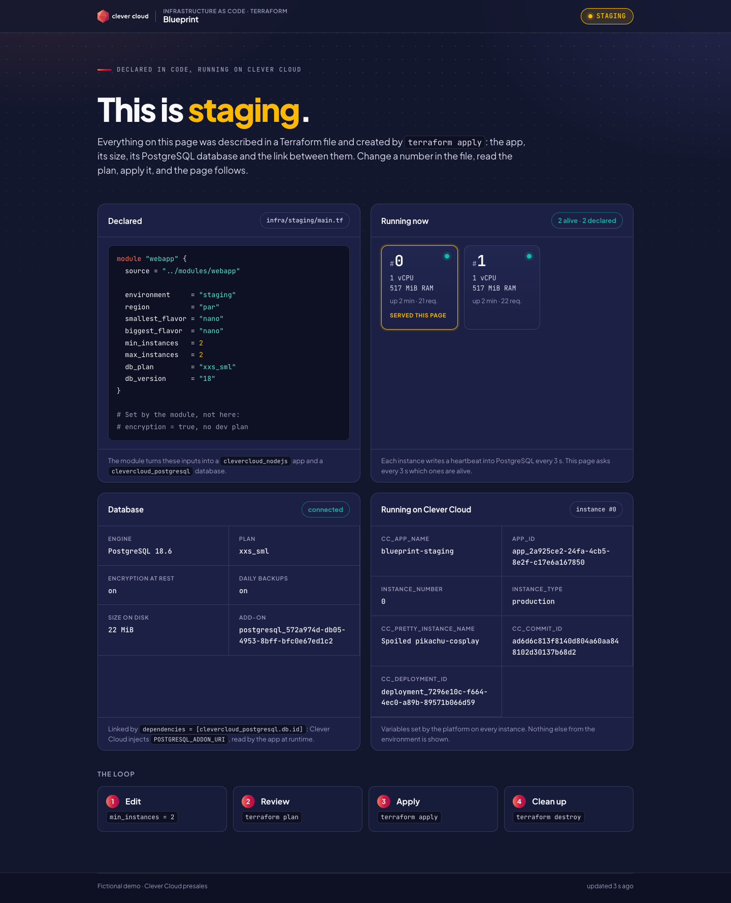
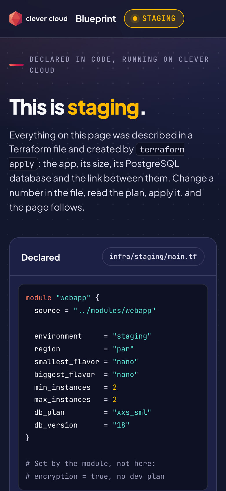
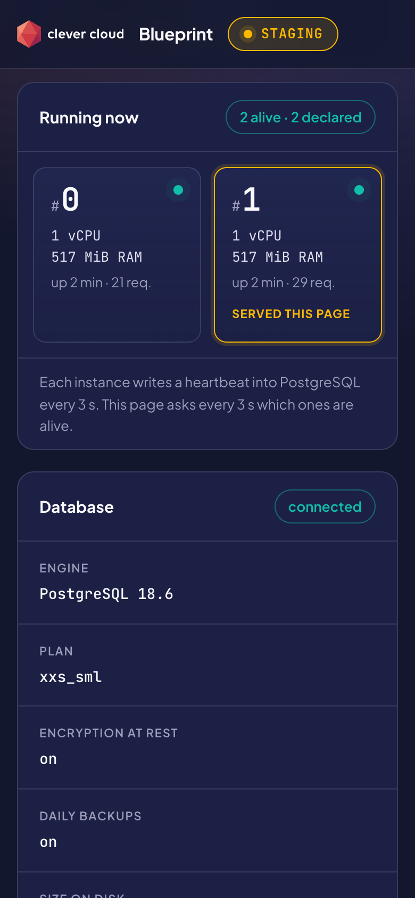

# Blueprint — Terraform on Clever Cloud

> A platform team describes its environments in code. Here, `infra/staging` and `infra/production` call the same module: a Node.js app, its PostgreSQL database **encrypted at rest**, the link between them, a declared size and an instance count. Their Terraform state lives on Clever Cloud too, in a **Cellar** bucket created by a small bootstrap stage, with a lock. `terraform plan` reads like a code review, `terraform apply` creates the lot in seconds, and the app shows what was declared next to what actually runs: every instance writes a heartbeat into PostgreSQL. Raise the instance count, read the diff in the plan, apply it, and a second instance lights up. Two `terraform destroy` leave nothing behind. Built on the official provider [`CleverCloud/clevercloud`](https://registry.terraform.io/providers/CleverCloud/clevercloud/latest) v3.



| Phone, the declaration | Phone, what runs |
|---|---|
|  |  |

**Run it yourself.** The hosted demo was taken down after the presales proof (November 2026). [Deploy on Clever Cloud](#deploy-on-clever-cloud) recreates the bootstrap and an environment in about 5 minutes, most of it the first build.

**Get certified.** This demo runs on Clever Cloud. To deploy your own apps the same way, get certified at the [Clever Cloud Academy](https://academy.clever.cloud/).

## What Terraform does here

| Where | Terraform feature | What you see |
|---|---|---|
| `infra/bootstrap` | `clevercloud_cellar` and `clevercloud_cellar_bucket`, local state | The bucket that keeps the state of the environments: nothing to create by hand before `terraform init` |
| `backend "s3"` in each environment | Terraform's own S3 backend, pointed at Cellar, with `use_lockfile = true` | One state per environment (`staging.tfstate`, `production.tfstate`) in Paris, and a lock while a plan or an apply runs |
| `local_sensitive_file` in the bootstrap | The backend settings written to `infra/cellar.s3.tfbackend` (mode 0600, ignored by git) | The Cellar keys go from Terraform to Terraform: never printed, never exported in a shell |
| `infra/modules/webapp` | A module: one shape for every environment | Staging and production differ by a few lines, never by structure |
| `infra/staging`, `infra/production` | One folder and one state per environment | A plan on staging can never touch production |
| `clevercloud_postgresql` | `plan = "xxs_sml"`, `encryption = true`, `backup = true` | **Database** card: plan, encryption at rest and backups, as read back from the API |
| `clevercloud_nodejs` | `smallest_flavor`, `biggest_flavor`, `min_instance_count`, `max_instance_count` | **Declared** card, and one tile per instance in **Running now** |
| `dependencies = [clevercloud_postgresql.db.id]` | The link between app and database | Clever Cloud injects `POSTGRESQL_ADDON_URI`; no credential is written in the code |
| `environment = { IAC_… }` | Environment variables | The values in **Declared** come from there |
| `deployment { repository = "file://…" }` | Terraform pushes the repository `HEAD` | No `clever deploy`: a new commit shows up in the next plan as `commit = "…" -> "…"` |
| `tags` | `env:staging`, `managed-by:terraform`, `demo:iac-terraform` | Tags on the app and the add-ons, read back in every plan |
| `validation` blocks | Guardrails of the module | `terraform plan` stops on `The dev plan is refused` or on `min_instances` above `max_instances` |
| `output "declared"` | A readable summary in every plan | The provider marks `environment` as sensitive, so the plan shows `(sensitive value)` there; the output shows the size in clear |

Encryption at rest is not a variable: the module sets it on every database. It is chosen when the database is created, so changing it would mean a new database, and the provider says so (`# forces replacement`).

## The demo, step by step

Proof run of 4 November 2026, region `par`, state in Cellar. Outputs are copied from the terminal; `...` marks lines left out.

**0. Bootstrap, once.** `terraform apply` in `infra/bootstrap` creates the Cellar add-on, the bucket and the backend file in 15 seconds:

```text
clevercloud_cellar.state: Creation complete after 13s [id=cellar_a2f9fead-5e40-4f6c-a232-35faf1236744]
clevercloud_cellar_bucket.state: Creation complete after 1s [id=blueprint-tfstate-bc95c2e1]
local_sensitive_file.backend: Creation complete after 0s [id=811a46ad7466e9abf899d129eda86e6626be0d2e]
Apply complete! Resources: 4 added, 0 changed, 0 destroyed.
```

Then, in `infra/staging`, `terraform init -backend-config=../cellar.s3.tfbackend` answers `Successfully configured the backend "s3"!`.

**1. Plan.** Two resources, nothing hidden except what is secret:

```text
  # module.webapp.clevercloud_nodejs.app will be created
  + resource "clevercloud_nodejs" "app" {
      + app_folder         = "app"
      + biggest_flavor     = "nano"
      + dependencies       = [
          + (known after apply),
        ]
      + environment        = (sensitive value)
      + max_instance_count = 1
      + min_instance_count = 1
      + name               = "blueprint-staging"
      + region             = "par"
      + smallest_flavor    = "nano"
      ...
      + deployment {
          + commit     = (known after apply)
          + repository = "file:///Users/vitio/ClaudeByVitio/demo-iac-terraform"
        }
    }

  # module.webapp.clevercloud_postgresql.db will be created
  + resource "clevercloud_postgresql" "db" {
      + backup           = true
      + encryption       = true
      + name             = "blueprint-staging-db"
      + password         = (sensitive value)
      + plan             = "xxs_sml"
      + region           = "par"
      + uri              = (sensitive value)
      + version          = "18"
      ...
    }

Plan: 2 to add, 0 to change, 0 to destroy.
```

**2. Apply.** `Acquiring state lock`, then the database and the app are created and the repository is pushed, in 4 seconds. The deployment starts at once; the database answers 40 seconds later and the app 80 seconds after the apply. The page says *This is staging*, one instance, `1 alive · 1 declared`, PostgreSQL 18.6, encryption at rest **on**.

**3. Change one thing.** In `infra/staging/main.tf`, `min_instances = 2` and `max_instances = 2`, then `terraform plan`:

```text
  # module.webapp.clevercloud_nodejs.app will be updated in-place
  ~ resource "clevercloud_nodejs" "app" {
      ~ environment        = (sensitive value)
        id                 = "app_b8b5effd-0b7b-4e4c-9d35-b9e7ecd0ce4d"
      ~ max_instance_count = 1 -> 2
      ~ min_instance_count = 1 -> 2
        name               = "blueprint-staging"
        tags               = [
            "demo:iac-terraform",
            "env:staging",
            "managed-by:terraform",
        ]
        # (10 unchanged attributes hidden)

        # (1 unchanged block hidden)
    }

Plan: 0 to add, 1 to change, 0 to destroy.

Changes to Outputs:
  ~ declared = {
      ~ instances  = "1" -> "2"
        # (3 unchanged attributes hidden)
    }
```

**4. Apply it.** The provider updates the scaling and, since `environment` changed, restarts the app. Clever Cloud starts the new instances before it stops the old one: for about three minutes **Running now** shows both generations, tagged *New deployment* or *Previous deployment*. Then it settles on `2 alive · 2 declared` (screenshots above).

**5. Destroy, environment first, bootstrap last.**

```text
module.webapp.clevercloud_nodejs.app: Destroying... [id=app_b8b5effd-0b7b-4e4c-9d35-b9e7ecd0ce4d]
module.webapp.clevercloud_nodejs.app: Destruction complete after 0s
module.webapp.clevercloud_postgresql.db: Destroying... [id=postgresql_06b7e702-3995-441f-aba5-58a871da1bca]
module.webapp.clevercloud_postgresql.db: Destruction complete after 1s
Apply complete! Resources: 0 added, 0 changed, 2 destroyed.
```

Then `terraform destroy` in `infra/bootstrap` empties the bucket (the states with it), deletes it and the Cellar add-on: `Resources: 0 added, 0 changed, 4 destroyed.` `clever applications` and `clever addon` then list nothing named `blueprint-*`.

A code change goes through the same loop: commit it, and the next plan shows `~ deployment { ~ commit = "cbf4ae8…" -> "ad6d6c8…" }` before Terraform pushes it.

`infra/production` runs the same loop on its own key in the same bucket, proved on Clever Cloud: `Plan: 2 to add` (flavor `nano to XS`, one instance), `terraform apply` in 12 s, and the page answered *This is production* 59 s later, its encrypted database connected. Destroy production first, the bootstrap last.

### Seen during the proof

- **State keys stay at the root of the bucket.** With `key = "staging/terraform.tfstate"`, `terraform destroy` of the bootstrap stopped on `The bucket you tried to delete is not empty`: provider 3.0.0 empties a bucket without listing inside folders. With `staging.tfstate` the bucket is emptied and deleted in one go (proved on a second full run).
- **The lock works on Cellar.** With `use_lockfile = true`, every plan and apply acquired and released the lock in the bucket, with no error.
- **The first push started no deployment, once.** On the first run, the app stayed *stopped* for five minutes after the first `apply`, with its commit recorded; the next `apply`, which pushed a new commit, deployed it at once. On the two later runs, the first push deployed straight away.
- **One database never started, once.** On the first run, the `xxs_sml` database was `ACTIVE` in the API but its port stayed closed for 25 minutes, with no log. An identical database created with clever-tools at that time answered within a minute, so the provider was not the cause. `terraform apply -replace=module.webapp.clevercloud_postgresql.db` created a new one, reachable 45 seconds later. `/health/deep` tells you in one call (503 until the database answers).
- **A new link alone does not restart the app.** The provider restarts an app when its `environment` changes, not when `dependencies` change, so after a database replacement the app kept the old address. The module puts the database ID in `environment` (`IAC_DB_ID`): a new database restarts the app by itself.

## Deploy on Clever Cloud

You need [Terraform](https://developer.hashicorp.com/terraform/install) 1.11 or later (tested with 1.16.5), [clever-tools](https://www.clever.cloud/developers/doc/cli/) with `clever login` done, and the ID of the organisation that will own the resources (`orga_…`, shown in the Console). OpenTofu was not tested here.

```bash
git clone https://github.com/Vitiosum/demo-iac-terraform.git
cd demo-iac-terraform/infra

export CC_ORGANISATION=orga_xxx                       # the organisation, not a secret
# Cellar does not accept the trailing checksums of recent AWS SDKs
export AWS_REQUEST_CHECKSUM_CALCULATION=when_required
export AWS_RESPONSE_CHECKSUM_VALIDATION=when_required

# 1. Once: the bucket for the states (writes infra/cellar.s3.tfbackend)
cd bootstrap
terraform init
terraform apply

# 2. An environment, its state in that bucket
cd ../staging                                         # or ../production
terraform init -backend-config=../cellar.s3.tfbackend
terraform plan -out=tfplan                            # read it: 2 to add
terraform apply tfplan
terraform output url
```

The app answers about a minute and a half after the `apply`, once built and started (`/health/deep` returns 200 when the database is reachable). If it stays stopped or the database does not answer, see [Seen during the proof](#seen-during-the-proof). Then make the change of [step 3](#the-demo-step-by-step).

To remove everything, in this order: `terraform destroy` in each environment folder, then in `infra/bootstrap`. Destroying the bootstrap first would delete the states of environments that still exist.

Each environment folder deploys the repository it sits in (`repo_root = "../.."`, `app_folder = "app"`). From another layout, pass both: `terraform plan -var repo_root=<path to the git root, relative to the folder> -var app_folder=<path of app/ from that root>`.

### Authentication

The provider reads the credentials of `clever login` from the clever-tools configuration file (`~/.config/clever-cloud/clever-tools.json`). Nothing is exported, nothing is written in the code. In a CI pipeline, export `CC_OAUTH_TOKEN` and `CC_OAUTH_SECRET` instead. According to the provider documentation, an API token (`CLEVER_API_TOKEN`, from `clever tokens create`) works for the API calls but cannot sign the git push: an app with a `deployment` block needs the OAuth credentials.

### Terraform state

- **Environments**: in the Cellar bucket, one key per environment, locked during each plan and apply. The bucket name, the endpoint and the Cellar keys reach `terraform init` through `infra/cellar.s3.tfbackend`, written by the bootstrap. Terraform also keeps a copy of these settings in `.terraform/` of each folder. Both are ignored by git.
- **Bootstrap**: its own state stays local (`infra/bootstrap/terraform.tfstate`, ignored by git): it cannot live in the bucket it creates.

A state holds secrets in clear text: the database password and URI, and the Cellar keys for the bootstrap. Plans only hide them. Never commit a state, a plan or the `.tfbackend` file.

## Variables

Set by Terraform on the app (`environment` map of the module):

| Variable | Role |
|---|---|
| `IAC_ENVIRONMENT` | `staging` or `production`: page title and colour |
| `IAC_SOURCE` | The file that declares the environment |
| `IAC_REGION`, `IAC_SMALLEST_FLAVOR`, `IAC_BIGGEST_FLAVOR`, `IAC_MIN_INSTANCES`, `IAC_MAX_INSTANCES` | The declared size, shown in **Declared** |
| `IAC_DB_PLAN`, `IAC_DB_VERSION` | The declared database |
| `IAC_DB_ENCRYPTION`, `IAC_DB_BACKUP` | Read back from the API by the provider, not copied from the file |
| `IAC_DB_ID` | The add-on ID: a new database changes it, so the provider restarts the app |
| `CC_HEALTH_CHECK_PATH` | `/health` |
| `APP_FOLDER` | `app`, from the `app_folder` attribute |

Injected by Clever Cloud through the link: `POSTGRESQL_ADDON_URI` and the other `POSTGRESQL_ADDON_*` variables. The app reads `POSTGRESQL_ADDON_URI` (or `DATABASE_URL` locally).

On your machine, for Terraform: `CC_ORGANISATION`, `AWS_REQUEST_CHECKSUM_CALCULATION` and `AWS_RESPONSE_CHECKSUM_VALIDATION`. None of them is a secret.

The **Running on Clever Cloud** card shows `CC_APP_NAME`, `APP_ID`, `INSTANCE_NUMBER`, `INSTANCE_TYPE`, `CC_PRETTY_INSTANCE_NAME`, `CC_COMMIT_ID` and `CC_DEPLOYMENT_ID`, and nothing else.

## Routes

`/` the page · `/api/state` what the page polls every 3 s (declaration, live instances, database) · `/health` (no database) · `/health/deep` (heartbeat round trip to PostgreSQL, 503 when unreachable).

## Code tour

```
infra/bootstrap/        main.tf: Cellar add-on, bucket, the backend file for the environments; local state
infra/modules/webapp/   the module: main.tf (database, app, link), variables.tf (guardrails), outputs.tf
infra/staging/          main.tf: S3 backend on Cellar, provider, module call with the staging size, outputs
infra/production/       same file, production size, its own key in the bucket
app/server.js           Node.js server, no framework: routes, heartbeat into PostgreSQL, clean exit on SIGTERM
app/public/             index.html, app.js (rendering, polling), app.css; cc-brand.css and cc-logo.svg from the Clever Brand Kit
app/test/               smoke test: npm test starts the real server and calls every route, without a database
PRESENTATION.md         the 5-minute video script, in French, in step with this code
```

Node.js 24, one dependency (`pg`). Each `infra/` folder commits its `.terraform.lock.hcl`.

## Run locally

```bash
cd app && npm install
IAC_ENVIRONMENT=staging IAC_MIN_INSTANCES=1 IAC_MAX_INSTANCES=2 PORT=8080 npm start   # without a database
DATABASE_URL=postgres://user@localhost:5432/blueprint npm start                    # with one
npm test
```

MIT License.
